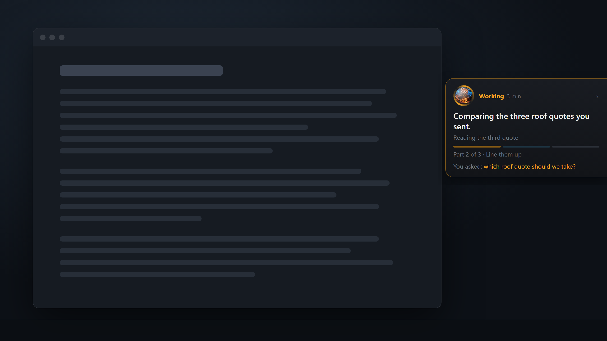
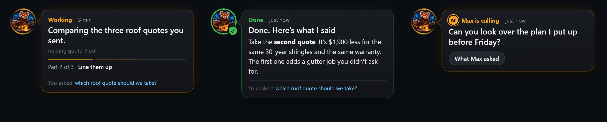

# The bubble

**See what your AI is doing, even when you're working in another window or on another screen.**

The bubble is your AI's face on your screen, with a speech bubble beside it. While it works, a ring breathes around its face and the bubble tells you what it's doing in a sentence, with bars for how far along the job is. When it's done, the ring turns green and its answer is right there to read. If you move to another screen while it works, it follows you there. Drag it anywhere you like, or click its face to fold it down to just the face.

This is the bubble I use with Odie every day. Before it, I kept clicking back into the chat just to check whether Odie was still working, stuck, or done. Now I keep working on whatever I'm doing, and Odie is right there beside me. It feels like having my AI sitting next to me while we work, and I think everyone working with an AI deserves that.

## Set it up

Paste this to your Claude, in the Claude app's Code tab:

> Set up the bubble for me from https://github.com/HunterBryson/the-bubble. Read its CLAUDE.md there first, then follow it. If anything asks for permission along the way, it's fine.

Your AI does the rest: it installs the bubble, connects it to itself, and shows you each moment once. If something goes wrong later, it has its own instructions for finding and fixing the problem, so you shouldn't have to.

Windows, with [Node](https://nodejs.org) and [Claude Code](https://claude.com/claude-code). It downloads about 100 MB.

Made by me, Hunter Bryson, and Odie. MIT license.
